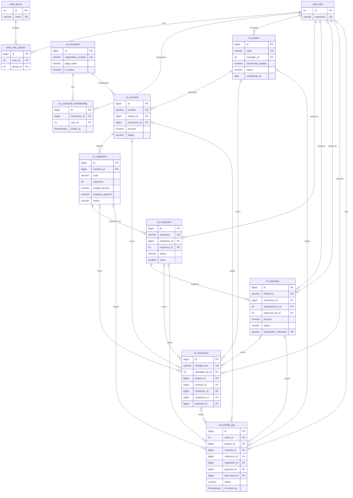

# NirmanSetu entity relationships

Names below are the actual database table names. Selected fields are shown;
timestamps and descriptive fields are omitted for readability. All domain PKs
are bigint identity columns. Django owns the authentication tables.

Each Document chooses **exactly one** of its five optional owner FKs; each
ActivityLog chooses **exactly one** of its six optional target FKs. These are
database CHECK constraints, not independent optional associations. A log actor
can be null for system events. Approval user is nullable until approval.

Composite uniqueness: `(contractor_id, user_id)` on contractor membership;
`(user_id, group_id)` on auth membership; `(contract_id, code)` and
`(contract_id, sequence)` on milestones. Completion is project status/date plus
optional certificate documents, not a duplicated ProjectCompletion table.
